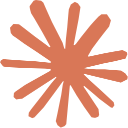
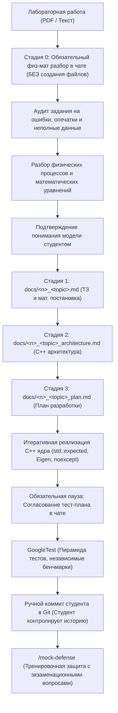

# 🌊 Computational Hydraulics Brain & AI Agent Skill
> **База знаний, архитектурные шаблоны C++ и агентский навык для курсов «Вычислительная гидравлика» и «Теория гидравлических цепей» (Кафедра ИСИТ, РГУ нефти и газа им. И.М. Губкина)**

[](https://en.cppreference.com/w/cpp/20)
[](https://gitlab.com/libeigen/eigen)
[](https://github.com/google/googletest)
[](LICENSE)

---

## 📌 О репозитории

Данный репозиторий представляет собой **активно развивающуюся инженерную базу знаний** и автономный специализированный навык (**AI Agent Skill** `computational-hydraulics`) для студентов и разработчиков, выполняющих лабораторные и расчетные работы по гидравлике трубопроводных систем и расчету сложных гидравлических сетей.

> [!NOTE]
> 🚧 **Проект в активной разработке**: База знаний не является окончательной и регулярно пополняется новыми темами, материалами лекций, методичками к лабораторным работам и архитектурными шаблонами кафедры ИСИТ.

Репозиторий решает главную проблему студента на 3 курсе: **лабораторные задания даются в сухом виде**, без явного раскрытия физической картины и математической постановки. Агент выступает в роли **опытного наставника и Senior C++ разработчика**:
1. Мягко разбирает с вами физическую суть и математическую модель до написания первой строчки кода.
2. Генерирует наглядные схемы, графы и структуру блочных матриц.
3. Проводит разработку по строгому **3-стадийному протоколу кафедры ИСИТ** (ТЗ $\to$ Архитектура $\to$ План $\to$ Код $\to$ GoogleTest).
4. Защищает от фатальных ошибок численных методов (сингулярность матриц, расходимость метода Ньютона, инверсия `A.inverse()`, забытый $P$-узел).
5. Проводит жесткий тренировочный прогон перед защитой лабораторной преподавателю (**Mock Defense**).

---

## 🗂 Структура репозитория

```text
hydraulics-brain/
├── README.md                           # Главное руководство и документация
├── .gitignore                          # Исключение артефактов сборки и кэшей
│
└── computational-hydraulics/           # Автономный инженерный AI Skill
    ├── SKILL.md                        # Главные инструкции агента (Сократический диалог, C++, валидация)
    ├── scripts/
    │   ├── install_skill.sh            # Автоматическая установка для Linux и macOS
    │   └── install_skill.ps1           # Автоматическая установка для Windows PowerShell
    ├── templates/                      # Готовые шаблоны артефактов для лабораторных
    │   ├── AGENTS.md                   # Правила проекта для корня репозитория студента (Doxygen, Code Style, Git)
    │   ├── tz_template.md              # Шаблон ТЗ и физико-математической постановки
    │   ├── architecture_template.md    # Шаблон C++ архитектуры (типы, солверы, лаконичный Doxygen)
    │   └── plan_template.md            # Шаблон пошагового плана и чек-листа
    └── references/                     # Фундаментальная инженерная база знаний
        ├── hydraulics_core.md          # 1D гидравлика: плотность ρ(T,p), вязкость, Re, Дарси-Вейсбах, гидроудар
        ├── sem2_guide.md               # 2 семестр: Бернулли, QP/PP задачи, профилирование, насосы, Task-паттерн
        ├── sem3_guide.md               # 3 семестр: ТГЦ, Eigen C++, PA=LU, МУД, блочные матрицы ККТ, графы
        ├── circuits_and_agentic.md     # Теория гидравлических цепей по Южанину + Агентский протокол ИСИТ
        ├── pitfalls_and_antipatterns.md# Топ-15 критических ловушек и антипаттернов (математика и C++)
        ├── googletest_verification_guide.md # 4-уровневая пирамида GoogleTest и независимые бенчмарки
        └── mock_defense_protocol.md    # Интерактивный симулятор защиты лабораторной (4 раунда)
```

---

## 🚀 Руководство по установке и использованию навыка

<p align="center">
  &nbsp;&nbsp;&nbsp;&nbsp;&nbsp;&nbsp;
  &nbsp;&nbsp;&nbsp;&nbsp;&nbsp;&nbsp;
  &nbsp;&nbsp;&nbsp;&nbsp;&nbsp;&nbsp;
  &nbsp;&nbsp;&nbsp;&nbsp;&nbsp;&nbsp;
  &nbsp;&nbsp;&nbsp;&nbsp;&nbsp;&nbsp;
  &nbsp;&nbsp;&nbsp;&nbsp;&nbsp;&nbsp;
  &nbsp;&nbsp;&nbsp;&nbsp;&nbsp;&nbsp;
  
</p>

---

Выберите наиболее удобный для вас вариант работы:
- **[Вариант 1. Локально прямо в проект (Рекомендуется)](#-вариант-1-локально-прямо-в-проект-рекомендуется)** — навык лежит прямо рядом с кодом вашей лабораторной. Не требует системной настройки, идеален для быстрого старта.
- **[Вариант 2. Глобально в систему](#-вариант-2-глобально-в-систему-для-всех-проектов)** — навык устанавливается один раз в системный каталог агента и доступен из любой папки на вашем компьютере.

---

### 📂 Вариант 1. Локально прямо в проект (Рекомендуется)

В этом варианте папка `computational-hydraulics` находится прямо внутри вашего рабочего проекта. Любой агент (Cursor, Windsurf, Codex, Claude Code, Cline, Aider) мгновенно подхватывает `SKILL.md` и все формулы из `references/` по прямым относительным ссылкам.

#### Способ А. Писать код прямо внутри этого репозитория
Самый быстрый старт — просто склонируйте этот репозиторий и создайте рабочие папки под вашу лабораторную:

```bash
git clone https://github.com/BugFix-develop/hydraulics-brainstorm.git my-lab
cd my-lab
mkdir docs src tests
```

#### Способ Б. Скопировать навык в уже существующую лабораторную работу
Если у вас уже есть начатый репозиторий с кодом, просто скопируйте в него папку `computational-hydraulics`:

 **Linux** /  **macOS**:
```bash
cp -r computational-hydraulics /path/to/my-lab/
```

 **Windows** (PowerShell):
```powershell
Copy-Item -Recurse -Force computational-hydraulics "C:\path\to\my-lab\"
```

*(Для Cursor, Windsurf или Cline скопируйте `SKILL.md` в файл проектных правил: `.cursorrules`, `.windsurfrules` или `.clinerules`).*

---

### 🌐 Вариант 2. Глобально в систему для всех проектов

В этом варианте навык устанавливается один раз в домашнюю директорию агента (`~/.agents/skills`, `~/.codex/skills`, `~/.claude/skills`) и автоматически активен во всех проектах на компьютере.

#### 📥 Шаг 1. Склонируйте репозиторий для установки
Склонируйте репозиторий в любое удобное место на диске (например, `~/projects` или `C:\Dev\`):
```bash
git clone https://github.com/BugFix-develop/hydraulics-brainstorm.git
cd hydraulics-brainstorm
```
*(Либо нажмите вверху **Code → Download ZIP**, распакуйте архив и откройте терминал внутри папки).*

#### ⚡ Шаг 2. Запустите автоустановку (в 1 клик)
Скрипт сам определит системные пути вашей ОС и настроит окружение:

 **Linux** /  **macOS** (Bash / Zsh):
```bash
./computational-hydraulics/scripts/install_skill.sh
```

 **Windows** (PowerShell):
```powershell
.\computational-hydraulics\scripts\install_skill.ps1
```

*(В появившемся меню введите номер нужного агента или `9` для установки всем сразу).*

#### 📦 Ручная глобальная установка (по желанию)
Если вы предпочитаете скопировать файлы вручную без скрипта, выберите вашу среду:

<details open>
<summary> &nbsp;<b><font size="+1">OpenAI (Codex Agent & ChatGPT)</font></b></summary>

<br/>

**Codex Agent:**

 **Linux** /  **macOS**:
```bash
mkdir -p ~/.codex/skills
cp -r computational-hydraulics ~/.codex/skills/
```

 **Windows** (PowerShell):
```powershell
New-Item -ItemType Directory -Force -Path "$HOME\.codex\skills"
Copy-Item -Recurse -Force computational-hydraulics "$HOME\.codex\skills\"
```

**ChatGPT (Web / Projects / Custom GPT):**
В [ChatGPT Projects](https://chatgpt.com): в поле *Custom Instructions* вставьте текст из `computational-hydraulics/SKILL.md`, а в *Knowledge* прикрепите файлы из `computational-hydraulics/references/`.
</details>

<details>
<summary> &nbsp;<b><font size="+1">Google Antigravity & Open Agent Skills</font></b></summary>

<br/>

 **Linux** /  **macOS**:
```bash
mkdir -p ~/.agents/skills
cp -r computational-hydraulics ~/.agents/skills/
```

 **Windows** (PowerShell):
```powershell
New-Item -ItemType Directory -Force -Path "$HOME\.agents\skills"
Copy-Item -Recurse -Force computational-hydraulics "$HOME\.agents\skills\"
```
</details>

<details>
<summary> &nbsp;<b><font size="+1">Anthropic Claude Code (CLI)</font></b></summary>

<br/>

 **Linux** /  **macOS**:
```bash
mkdir -p ~/.claude/skills
cp -r computational-hydraulics ~/.claude/skills/
echo -e "\n# Computational Hydraulics Skill\nAlways refer to ~/.claude/skills/computational-hydraulics/SKILL.md when solving hydraulics tasks.\n" >> ~/.claude/CLAUDE.md
```

 **Windows** (PowerShell):
```powershell
New-Item -ItemType Directory -Force -Path "$HOME\.claude\skills"
Copy-Item -Recurse -Force computational-hydraulics "$HOME\.claude\skills\"
Add-Content -Path "$HOME\.claude\CLAUDE.md" -Value "`n# Computational Hydraulics Skill`nAlways refer to $HOME\.claude\skills\computational-hydraulics\SKILL.md when solving hydraulics tasks.`n"
```
</details>

<details>
<summary> &nbsp;<b><font size="+1">Cursor AI IDE (Cursor Rules 2.0)</font></b></summary>

<br/>

Скопируйте навык `SKILL.md` в правила вашего проекта:

 **Linux** /  **macOS**:
```bash
cp computational-hydraulics/SKILL.md /path/to/my-lab/.cursorrules
```

 **Windows** (PowerShell):
```powershell
Copy-Item -Force computational-hydraulics\SKILL.md "C:\path\to\my-lab\.cursorrules"
```
</details>

<details>
<summary> &nbsp;<b><font size="+1">Windsurf (Codeium)</font></b></summary>

<br/>

Скопируйте навык `SKILL.md` в правила рабочего пространства:

 **Linux** /  **macOS**:
```bash
cp computational-hydraulics/SKILL.md /path/to/my-lab/.windsurfrules
```

 **Windows** (PowerShell):
```powershell
Copy-Item -Force computational-hydraulics\SKILL.md "C:\path\to\my-lab\.windsurfrules"
```
</details>

<details>
<summary> &nbsp;<b><font size="+1">Roo Code & Cline (VS Code Extensions)</font></b></summary>

<br/>

Скопируйте навык `SKILL.md` в системные инструкции:

 **Linux** /  **macOS**:
```bash
cp computational-hydraulics/SKILL.md /path/to/my-lab/.clinerules
```

 **Windows** (PowerShell):
```powershell
Copy-Item -Force computational-hydraulics\SKILL.md "C:\path\to\my-lab\.clinerules"
```
</details>

<details>
<summary> &nbsp;<b><font size="+1">Aider CLI (Terminal Pair Programmer)</font></b></summary>

<br/>

 **Linux** /  **macOS**:
```bash
aider --read ~/.agents/skills/computational-hydraulics/SKILL.md
```

 **Windows** (PowerShell):
```powershell
aider --read "$HOME\.agents\skills\computational-hydraulics\SKILL.md"
```
</details>

<details>
<summary> &nbsp;<b><font size="+1">GitHub Copilot (VS Code / JetBrains / CLI)</font></b></summary>

<br/>

Скопируйте навык `SKILL.md` в инструкции репозитория:

 **Linux** /  **macOS**:
```bash
mkdir -p /path/to/my-lab/.github
cp computational-hydraulics/SKILL.md /path/to/my-lab/.github/copilot-instructions.md
```

 **Windows** (PowerShell):
```powershell
New-Item -ItemType Directory -Force -Path "C:\path\to\my-lab\.github"
Copy-Item -Force computational-hydraulics\SKILL.md "C:\path\to\my-lab\.github\copilot-instructions.md"
```
</details>

---

### ✅ Шаг 3. Как проверить активацию навыка

1. Откройте вашего ИИ-агента и прикрепите файл вашей лабораторной работы (PDF или текст задания) со словами:
   > *«Привет! Помоги решить эту лабораторную работу по гидравлике.»*
2. **Если навык активен:**
   - Агент **НЕ бросается создавать файлы `docs/` или писать код**.
   - Агент первым делом предлагает **разобрать физическую и математическую модель** задачи.
   - Проверяет задание на опечатки и физические ошибки методички (и сразу сообщает о них).
   - Объясняет физику процессов и уравнения простыми словами и схемами.
   - **Ждёт вашего подтверждения понимания** перед тем, как перейти к оформлению ТЗ и архитектуры.
   - Напоминает, что коммиты в Git вы делаете **лично**.

---

## 🛠 Рабочий процесс студента и агента



### 1. Стадия 0: Инженерный разбор перед созданием любых файлов
Агент **строго заблокирован от преждевременной генерации файлов** (`docs/*.md`, архитектуры, кода), пока вы лично не разберётесь в задаче:
- **Аудит методички:** агент ищет скрытые опечатки в формулах, нестыковки размерностей и недостающие граничные условия (например, забытый опорный узел давления $P$). Если есть ошибки — агент сразу указывает на них.
- **Физическая картина:** разбираются действующие силы, режим течения ($Re$), гидроудар или кавитация, потери энергии.
- **Математическая модель:** определяются точные уравнения (Бернулли, Дарси-Вейсбах, Кирхгоф, Todini GGM), блочная матрица KKT и метод решения.
- **Шлюз перехода:** только после того, как студент подтверждает: *«Физику и уравнения понял, давай фиксировать ТЗ»*, создаётся первый файл `docs/<n>_<topic>.md`.

### 2. Строгий 3-стадийный протокол ИСИТ (после Стадии 0)
Никакого кода до утверждения проектной документации в `docs/`:
1. `docs/<n>_<topic>.md` — математическая постановка, единицы измерения в СИ, граничные условия.
2. `docs/<n>_<topic>_architecture.md` — структуры данных, RAII-обертки, отсутствие голых указателей, Doxygen-документация.
3. `docs/<n>_<topic>_plan.md` — атомарные чек-боксы шагов реализации и верификации.

### 3. Золотое правило работы с Git
> **Важно**: Агент никогда не коммитит и не пушит код автоматически! Студент сам выполняет `git add`, `git commit` и `git push`, полностью контролируя ветки и историю своего репозитория.

### 4. Обязательная пауза перед тестами и стандарт GoogleTest
- **Остановка перед написанием тестов:** Агент **не имеет права сразу генерировать тесты**. Перед созданием файлов в `tests/` агент останавливается и презентует студенту 4 уровня тестов: аналитические эталоны, физические инварианты, граничные случаи и контракты.
- **Запрет тавтологий:** Категорически запрещены тесты-подгонки (`EXPECT_DOUBLE_EQ(solve(x), solve(x))`).
- **Независимые эталоны:** Эталонные значения берутся из ручного аналитического расчета в ТЗ или проверенных задачников (Идельчик, Альтшуль, Лурье).
- **Контроль инвариантов:** Проверка баланса массы в узлах ($\|Ax - Q\|_\infty < 10^{-8}$), монотонности потерь напора, нулевого расхода ($Q=0 \implies h_{\text{тр}}=0$).
- **Особые случаи:** Тестирование сингулярности матрицы при отсутствии $P$-узла (`EXPECT_THROW` через ранг `FullPivLU`), отрицательного расхода ($Q|Q|$).
- **Шлюз тестов:** Агент начинает писать код тестов только после того, как студент подтвердит понимание тест-плана в чате.

### 5. Режим Mock Defense (`/mock-defense`)
После завершения работы агент запускает симулятор защиты:
- Раунд 1: Физика процессов (закон сохранения импульса, потеря напора, кавитация).
- Раунд 2: Численные методы (почему $PA=LU$, а не `A.inverse()`, сходимость МУД).
- Раунд 3: C++ & Архитектура (Move-семантика, шаблоны выражений Eigen `const auto&`, cache-locality).
- Раунд 4: Анализ кода и разбор ошибок.

---

## 📚 Литература и фундаментальные источники

База знаний и алгоритмы верифицированы по классическим фундаментальным трудам:
1. **Лурье М.В.** *Математическое моделирование процессов трубопроводного транспорта нефти, нефтепродуктов и газа.* — М.: ФГУП Изд-во «Нефть и газ» РГУ нефти и газа им. И.М. Губкина, 2012. — 456 с.
2. **Лурье М.В.** *Трубопроводный транспорт нефти.* — М.: ФГУП Изд-во «Нефть и газ» РГУ нефти и газа им. И.М. Губкина, 2003.
3. **Идельчик И.Е.** *Справочник по гидравлическим сопротивлениям.* — М.: Машиностроение, 1992. — 672 с.
4. **Альтшуль А.Д.** *Гидравлические сопротивления.* — М.: Недра, 1982. — 224 с.
5. **Некрасов Б.Б.** *Гидравлика и гидропривод.* — М.: Высшая школа, 1989. — 296 с.
6. **Южанин В.В.** *Материалы лекций и практических занятий по теории гидравлических цепей и численным методам.* — Кафедра ИСИТ, РГУ нефти и газа им. И.М. Губкина.

---

## 🤝 Вклад и участие
Если вы студент или преподаватель Губкинского университета и хотите дополнить базу новыми темами, методичками, расчетными схемами или тестами:
1. Создайте `fork` репозитория в свой GitHub-аккаунт.
2. Создайте тематическую ветку (`git checkout -b feature/new-hydraulic-case`).
3. Сделайте коммит (`git commit -m "feat: add local resistance calculation for venturi nozzle"`).
4. Отправьте **Pull Request** на рассмотрение. Прямой пуш в ветку `main` закрыт: все изменения попадают в основную ветку только после личной проверки и аппрува мейнтейнером.

---

## 📄 Лицензия

Данный проект распространяется под открытой и свободной лицензией **[MIT License](LICENSE)**.

Вы можете свободно использовать базу знаний, шаблоны C++ и агентский навык в учебных, исследовательских и коммерческих целях, модифицировать их и включать в свои проекты с сохранением авторских прав.

<details>
<summary><b>Показать полный текст лицензии MIT</b></summary>

```text
MIT License

Copyright (c) 2026 BugFix-develop (Muslim) and Hydraulics Brainstorm Contributors

Permission is hereby granted, free of charge, to any person obtaining a copy
of this software and associated documentation files (the "Software"), to deal
in the Software without restriction, including without limitation the rights
to use, copy, modify, merge, publish, distribute, sublicense, and/or sell
copies of the Software, and to permit persons to whom the Software is
furnished to do so, subject to the following conditions:

The above copyright notice and this permission notice shall be included in all
copies or substantial portions of the Software.

THE SOFTWARE IS PROVIDED "AS IS", WITHOUT WARRANTY OF ANY KIND, EXPRESS OR
IMPLIED, INCLUDING BUT NOT LIMITED TO THE WARRANTIES OF MERCHANTABILITY,
FITNESS FOR A PARTICULAR PURPOSE AND NONINFRINGEMENT. IN NO EVENT SHALL THE
AUTHORS OR COPYRIGHT HOLDERS BE LIABLE FOR ANY CLAIM, DAMAGES OR OTHER
LIABILITY, WHETHER IN AN ACTION OF CONTRACT, TORT OR OTHERWISE, ARISING FROM,
OUT OF OR IN CONNECTION WITH THE SOFTWARE OR THE USE OR OTHER DEALINGS IN THE
SOFTWARE.
```
</details>
