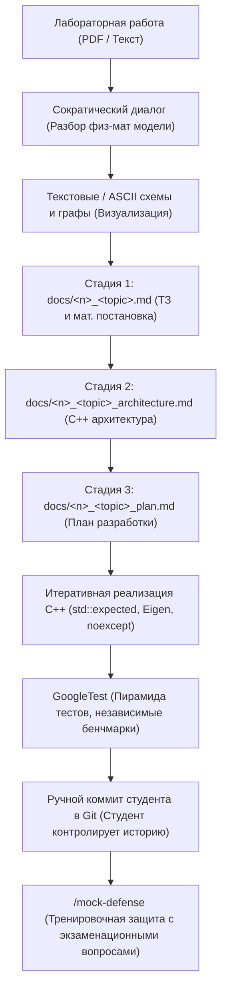

# 🌊 Computational Hydraulics Brain & AI Agent Skill
> **База знаний, архитектурные шаблоны C++ и агентский навык для курсов «Вычислительная гидравлика» и «Теория гидравлических цепей» (Кафедра ИСИТ, РГУ нефти и газа им. И.М. Губкина)**

[](https://en.cppreference.com/w/cpp/20)
[](https://gitlab.com/libeigen/eigen)
[](https://github.com/google/googletest)
[](https://www.python.org/)
[](LICENSE)

---

## 📌 О репозитории

Данный репозиторий представляет собой законченную инженерную базу знаний и автономный специализированный навык (**AI Agent Skill** `computational-hydraulics`) для студентов и разработчиков, выполняющих лабораторные и исследовательские работы по гидравлике трубопроводных систем и расчету сложных гидравлических сетей.

Репозиторий решает главную проблему студента на 3 курсе: **лабораторные задания даются в сухом виде**, без явного раскрытия физической картины и математической постановки. Агент выступает в роли **опытного наставника и Senior C++ разработчика**:
1. Мягко разбирает с вами физическую суть и математическую модель до написания первой строчки кода.
2. Генерирует наглядные схемы, графы и структуру блочных матриц.
3. Проводит разработку по строгому **3-стадийному протоколу кафедры ИСИТ** (ТЗ $\to$ Архитектура $\to$ План $\to$ Код $\to$ GoogleTest).
4. Защищает от фатальных ошибок численных методов (сингулярность матриц, расходимость метода Ньютона, инверсия `A.inverse()`, забытый $P$-узел).
5. Проводит жесткий тренировочный прогон перед защитой лабораторной преподавателю (**Mock Defense**).

---

## 🗂 Структура репозитория

```text
hydraulics-brain/
├── README.md                           # Главное руководство и документация
├── .gitignore                          # Исключение артефактов сборки и кэшей
│
└── computational-hydraulics/           # Автономный инженерный AI Skill
    ├── SKILL.md                        # Главные инструкции агента (Сократический диалог, C++, валидация)
    ├── scripts/
    │   └── hydraulics_calculator.py    # Интерактивный CLI-калькулятор единиц, Re, lambda, потерь и гидроудара
    ├── templates/                      # Готовые шаблоны артефактов для лабораторных
    │   ├── AGENTS.md                   # Правила проекта для корня репозитория студента (Doxygen, Code Style, Git)
    │   ├── tz_template.md              # Шаблон ТЗ и физико-математической постановки
    │   ├── architecture_template.md    # Шаблон C++ архитектуры (типы, солверы, лаконичный Doxygen)
    │   └── plan_template.md            # Шаблон пошагового плана и чек-листа
    └── references/                     # Фундаментальная инженерная база знаний
        ├── hydraulics_core.md          # 1D гидравлика: плотность ρ(T,p), вязкость, Re, Дарси-Вейсбах, гидроудар
        ├── sem2_guide.md               # 2 семестр: Бернулли, QP/PP задачи, профилирование, насосы, Task-паттерн
        ├── sem3_guide.md               # 3 семестр: ТГЦ, Eigen C++, PA=LU, МУД, блочные матрицы ККТ, графы
        ├── circuits_and_agentic.md     # Теория гидравлических цепей по Южанину + Агентский протокол ИСИТ
        ├── pitfalls_and_antipatterns.md# Топ-15 критических ловушек и антипаттернов (математика и C++)
        ├── googletest_verification_guide.md # 4-уровневая пирамида GoogleTest и независимые бенчмарки
        └── mock_defense_protocol.md    # Интерактивный симулятор защиты лабораторной (4 раунда)
```

---

## 🚀 Установка навыка для различных AI-агентов

Навык `computational-hydraulics` разработан по открытому стандарту **Open Agent Skills** и совместим со всеми современными агентскими средами.

### ⚡ Быстрая автоматическая установка (One-Click Script)

В репозиторий встроен интерактивный скрипт установки, который настроит окружение за одну команду:
```bash
# Интерактивное меню выбора агента
./computational-hydraulics/scripts/install_skill.sh

# Или прямая установка под конкретную среду:
./computational-hydraulics/scripts/install_skill.sh --antigravity   # Google Antigravity & Open Agent Skills
./computational-hydraulics/scripts/install_skill.sh --claude        # Claude Code (Anthropic CLI)
./computational-hydraulics/scripts/install_skill.sh --cursor        # Cursor AI IDE
./computational-hydraulics/scripts/install_skill.sh --windsurf      # Windsurf (Codeium)
./computational-hydraulics/scripts/install_skill.sh --cline         # Cline & Roo Code
./computational-hydraulics/scripts/install_skill.sh --aider         # Aider CLI
./computational-hydraulics/scripts/install_skill.sh --copilot       # GitHub Copilot
./computational-hydraulics/scripts/install_skill.sh --all           # Установить для всех сред сразу
```

---

### 📦 Ручная установка для каждого агента

<details open>
<summary><b>1. 🪐 Google Antigravity (AGY) & Open Agent Skills</b></summary>

Google Antigravity автоматически считывает навыки из стандартной глобальной папки `~/.agents/skills/` или локальной папки `.agents/skills/` в корне проекта:
- **Глобальная установка (для всех проектов пользователя):**
  ```bash
  mkdir -p ~/.agents/skills
  cp -r computational-hydraulics ~/.agents/skills/
  ```
- **Локально в проекте с лабораторной:**
  ```bash
  mkdir -p /path/to/my-lab/.agents/skills
  cp -r computational-hydraulics /path/to/my-lab/.agents/skills/
  cp computational-hydraulics/templates/AGENTS.md /path/to/my-lab/AGENTS.md
  ```
</details>

<details>
<summary><b>2. 🤖 Claude Code (Anthropic CLI)</b></summary>

Claude Code считывает инструкции из глобального файла `~/.claude/CLAUDE.md` или локального `CLAUDE.md`:
- **Глобальная установка:**
  ```bash
  mkdir -p ~/.claude/skills
  cp -r computational-hydraulics ~/.claude/skills/
  echo -e "\n# Computational Hydraulics Skill\nAlways refer to ~/.claude/skills/computational-hydraulics/SKILL.md when solving pipeline hydraulics, TGC circuits, and C++ numerical tasks.\n" >> ~/.claude/CLAUDE.md
  ```
- **В конкретном проекте:**
  Скопируйте шаблон регламента в корень репозитория как `CLAUDE.md`:
  ```bash
  cp computational-hydraulics/templates/AGENTS.md /path/to/my-lab/CLAUDE.md
  ```
</details>

<details>
<summary><b>3. ⚡ Cursor AI IDE (Cursor Rules 2.0)</b></summary>

Cursor поддерживает современные проектные правила в каталоге `.cursor/rules/*.mdc`:
- **В вашем C++ проекте:**
  ```bash
  mkdir -p /path/to/my-lab/.cursor/rules
  ```
  Создайте файл `.cursor/rules/hydraulics.mdc`:
  ```yaml
  ---
  description: Computational hydraulics, Eigen linear systems, and strict 3-stage agentic workflow
  globs: src/**/*.cpp, src/**/*.h, tests/**/*.cpp, docs/**/*.md
  ---

  # Computational Hydraulics & Agentic Protocol
  Strictly follow rules in ~/.agents/skills/computational-hydraulics/SKILL.md:
  1. Follow the 3-stage protocol: ТЗ -> Architecture -> Plan -> GoogleTests.
  2. Eigen: NEVER use `A.inverse() * b`. Use PartialPivLU or FullPivLU.
  3. Git: NEVER commit or push automatically. Developer commits manually.
  4. Code style: snake_case, structs end with `_t`, concise 1-line Doxygen comments with SI units.
  ```
- **Или классический `.cursorrules` в корне проекта:**
  ```bash
  cp computational-hydraulics/templates/AGENTS.md /path/to/my-lab/.cursorrules
  ```
</details>

<details>
<summary><b>4. 🏄 Windsurf (Codeium)</b></summary>

Windsurf использует файл правил `.windsurfrules` в корне проекта или глобальные правила:
- **В проекте:**
  ```bash
  cp computational-hydraulics/templates/AGENTS.md /path/to/my-lab/.windsurfrules
  ```
- **Глобально:** добавьте директиву в `~/.codeium/windsurf/memories/global_rules.md`:
  `Include and strictly obey instructions from ~/.agents/skills/computational-hydraulics/SKILL.md`
</details>

<details>
<summary><b>5. 🧩 Cline & Roo Code (VS Code Extensions)</b></summary>

Cline и Roo Code используют кастомные инструкции:
- **В проекте:**
  ```bash
  cp computational-hydraulics/templates/AGENTS.md /path/to/my-lab/.clinerules
  ```
- **Глобально (в настройках VS Code):**
  Откройте настройки расширения Cline/Roo Code $\to$ *Custom Instructions for All Prompts* $\to$ вставьте:
  `Read and strictly follow rules in ~/.agents/skills/computational-hydraulics/SKILL.md`
</details>

<details>
<summary><b>6. 💻 Aider CLI (Terminal Pair Programmer)</b></summary>

Aider считывает внешние правила через конфигурационный файл `~/.aider.conf.yml` или флаг `--read`:
- **В глобальном конфиге `~/.aider.conf.yml`:**
  ```yaml
  read:
    - ~/.agents/skills/computational-hydraulics/SKILL.md
    - ~/.agents/skills/computational-hydraulics/references/pitfalls_and_antipatterns.md
  ```
- **При запуске из командной строки:**
  ```bash
  aider --read ~/.agents/skills/computational-hydraulics/SKILL.md
  ```
</details>

<details>
<summary><b>7. 🐙 GitHub Copilot (VS Code / JetBrains / CLI)</b></summary>

GitHub Copilot автоматически считывает проектные инструкции из `.github/copilot-instructions.md`:
```bash
mkdir -p /path/to/my-lab/.github
cp computational-hydraulics/templates/AGENTS.md /path/to/my-lab/.github/copilot-instructions.md
```
</details>

---

## 🛠 Рабочий процесс студента и агента



### 1. Сократический диалог перед кодом
Агент не вываливает сразу портянку C++ кода. Сначала он задает студенту наводящие вопросы:
- Какова физическая постановка (QP или PP задача, несжимаемая жидкость или реальный газ)?
- В какой зоне сопротивления работает трубопровод (гидравлически гладкая, переходная, шероховатая)?
- Корректен ли граф сети (нет ли изолированных компонент, зафиксирован ли хотя бы один узел по давлению)?

### 2. Строгий 3-стадийный протокол ИСИТ
Никакого кода до утверждения проектной документации в `docs/`:
1. `docs/<n>_<topic>.md` — математическая постановка, единицы измерения в СИ, граничные условия.
2. `docs/<n>_<topic>_architecture.md` — структуры данных, RAII-обертки, отсутствие голых указателей, Doxygen-документация.
3. `docs/<n>_<topic>_plan.md` — атомарные чек-боксы шагов реализации и верификации.

### 3. Золотое правило работы с Git
> **Важно**: Агент никогда не коммитит и не пушит код автоматически! Студент сам выполняет `git add`, `git commit` и `git push`, полностью контролируя ветки и историю своего репозитория.

### 4. Стандарт GoogleTest без тавтологий
- Запрещены тавтологические тесты (`EXPECT_DOUBLE_EQ(solve(x), solve(x))`).
- Эталонные значения рассчитываются независимым аналитическим скриптом или берутся из проверенных задачников (Идельчик, Альтшуль, Лурье).
- Обязательная проверка краевых случаев: $Re \to 0$, $Q \to 0$, $D \to \infty$, вырожденные матрицы, обратный ток.

### 5. Режим Mock Defense (`/mock-defense`)
После завершения работы агент запускает симулятор защиты:
- Раунд 1: Физика процессов (закон сохранения импульса, потеря напора, кавитация).
- Раунд 2: Численные методы (почему $PA=LU$, а не `A.inverse()`, сходимость МУД).
- Раунд 3: C++ & Архитектура (Move-семантика, шаблоны выражений Eigen `const auto&`, cache-locality).
- Раунд 4: Анализ кода и разбор ошибок.

---

## 🧮 Инженерный калькулятор (`hydraulics_calculator.py`)

В репозиторий встроен автономный инструмент верификации гидравлических расчетов без сторонних зависимостей (чистый Python 3).

### Интерактивный режим
```bash
python3 computational-hydraulics/scripts/hydraulics_calculator.py
```

### Командная строка (CLI)
- **Конвертация единиц:**
  ```bash
  python3 computational-hydraulics/scripts/hydraulics_calculator.py unit --val 350 --from_unit "m3/h" --to_unit "m3/s"
  python3 computational-hydraulics/scripts/hydraulics_calculator.py unit --val 6.4 --from_unit "MPa" --to_unit "Pa"
  python3 computational-hydraulics/scripts/hydraulics_calculator.py unit --val 25 --from_unit "cSt" --to_unit "m2/s"
  ```

- **Расчет числа Рейнольдса ($Re$):**
  ```bash
  python3 computational-hydraulics/scripts/hydraulics_calculator.py reynolds -v 1.85 -d 0.5 -nu 1.5e-5
  ```

- **Коэффициент гидравлического сопротивления ($\lambda$ по Альтшулю/Блазиусу/Шифринсону):**
  ```bash
  python3 computational-hydraulics/scripts/hydraulics_calculator.py lambda -re 61666 -d 0.5 -k 0.0001
  ```

- **Потери напора по Дарси-Вейсбаху:**
  ```bash
  python3 computational-hydraulics/scripts/hydraulics_calculator.py loss -l 10000 -d 0.5 -v 1.85 -re 61666 -k 0.0001
  ```

- **Плотность нефти/нефтепродукта $\rho(T, p)$:**
  ```bash
  python3 computational-hydraulics/scripts/hydraulics_calculator.py density --rho20 850 --t 15 --p 5000000
  ```

- **Гидравлический удар по Жуковскому:**
  ```bash
  python3 computational-hydraulics/scripts/hydraulics_calculator.py hammer -l 5000 -d 0.5 -e 0.01 -v 1.85 -rho 850 -ef 1.5e9 -ep 2.0e11 -ts 1.2
  ```

---

## 📚 Литература и фундаментальные источники

База знаний и алгоритмы верифицированы по классическим фундаментальным трудам:
1. **Лурье М.В.** *Математическое моделирование процессов трубопроводного транспорта нефти, нефтепродуктов и газа.* — М.: ФГУП Изд-во «Нефть и газ» РГУ нефти и газа им. И.М. Губкина, 2012. — 456 с.
2. **Лурье М.В.** *Трубопроводный транспорт нефти.* — М.: ФГУП Изд-во «Нефть и газ» РГУ нефти и газа им. И.М. Губкина, 2003.
3. **Идельчик И.Е.** *Справочник по гидравлическим сопротивлениям.* — М.: Машиностроение, 1992. — 672 с.
4. **Альтшуль А.Д.** *Гидравлические сопротивления.* — М.: Недра, 1982. — 224 с.
5. **Некрасов Б.Б.** *Гидравлика и гидропривод.* — М.: Высшая школа, 1989. — 296 с.
6. **Южанин В.В.** *Материалы лекций и практических занятий по теории гидравлических цепей и численным методам.* — Кафедра ИСИТ, РГУ нефти и газа им. И.М. Губкина.

---

## 🤝 Вклад и участие
Если вы студент или преподаватель Губкинского университета и хотите дополнить базу новыми методичками, расчетными схемами или тестами:
1. Создайте `fork` репозитория.
2. Создайте ветку под вашу фичу (`git checkout -b feature/new-hydraulic-case`).
3. Сделайте коммит (`git commit -m "feat: add local resistance calculation for venturi nozzle"`).
4. Создайте `Pull Request`.
