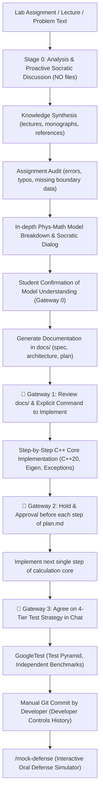

# 🌊 Computational Hydraulics Brain & AI Agent Skill
> **Knowledge base, C++ architecture patterns, and autonomous AI Agent Skill for Computational Hydraulics and Hydraulic Circuit Theory (ATP Department, Gubkin Russian State University of Oil and Gas)**

[](https://en.cppreference.com/w/cpp/20)
[](https://gitlab.com/libeigen/eigen)
[](https://github.com/google/googletest)
[](LICENSE)

---

## 📌 About the Repository

This repository is an **actively developing engineering knowledge base** and autonomous specialized skill (**AI Agent Skill** `computational-hydraulics`) for students, researchers, and software engineers solving pipeline hydraulics problems and simulating complex hydraulic networks.

> [!NOTE]
> 🚧 **Active Development**: This knowledge base is continuously expanded with lecture materials, laboratory assignment guides, and C++ architectural standards of the ATP Department.

The repository addresses a major challenge in computational engineering education: **assignments are often given as bare mathematical tasks**, without clear insight into the underlying physical phenomena or numerical formulation. The agent acts as an **experienced mentor and Senior C++ engineer**:
1. Conducts a dialogical Socratic walkthrough of the physical phenomena and mathematical formulation before a single line of code is written.
2. Generates schematic diagrams, flow graphs, and block matrix layouts.
3. Guides implementation through the strict **3-stage ATP Department protocol** (Spec → Architecture → Plan → Implementation → GoogleTest).
4. Prevents fatal numerical and algorithmic pitfalls (matrix singularity, Newton divergence, `A.inverse()` calls, missing reference pressure nodes).
5. Conducts an interactive training defense simulation before oral evaluation (**Mock Defense**).

> [!TIP]
> 📖 **Getting Started, Agent Communication Protocol & Phrase Cheat Sheet:**  
> Read the complete step-by-step user guide: **[USER_GUIDE.md](USER_GUIDE.md)**.

---

## 🗂 Repository Structure

```text
hydraulics-brain/
├── README.md                           # Main repository guide and documentation
├── USER_GUIDE.md                       # Complete step-by-step instructions: dialog, gateways, cheat sheet
├── .gitignore                          # Build artifacts and cache ignore rules
├── AGENTS.md                           # Mandatory root development regulation & code quality standards
│
└── computational-hydraulics/           # Autonomous Engineering AI Skill
    ├── SKILL.md                        # Primary agent instructions (Socratic dialog, C++, validation)
    ├── USER_GUIDE.md                   # Local copy of user guide
    ├── scripts/
    │   ├── install_skill.sh            # Automated installer for Linux & macOS
    │   └── install_skill.ps1           # Automated installer for Windows PowerShell
    ├── templates/                      # Artifact templates for laboratory assignments
    │   ├── AGENTS.md                   # Project rules template for student repository root
    │   ├── tz_template.md              # Specification & physics-math model template
    │   ├── architecture_template.md    # C++ architecture template (types, solvers, concise Doxygen)
    │   └── plan_template.md            # Step-by-step implementation plan & checklist template
    └── references/                     # Fundamental engineering knowledge base
        ├── hydraulics_core.md          # 1D pipe flow: density ρ(T,p), viscosity, Re, Darcy-Weisbach, water hammer
        ├── sem2_guide.md               # Pipeline modeling: Bernoulli, QP/PP problems, elevation profiling, pumps
        ├── sem3_guide.md               # Hydraulic circuit theory (TGC): Eigen C++, Todini GGM, KKT block systems
        ├── circuits_and_agentic.md     # Yuzhanin network formalisms & ATP agentic protocol
        ├── pitfalls_and_antipatterns.md# Top-15 critical numerical and C++ pitfalls
        ├── googletest_verification_guide.md # 4-tier GoogleTest pyramid and independent benchmarks
        └── mock_defense_protocol.md    # Interactive oral defense simulator (4 rounds)
```

---

## 🚀 Skill Installation & Setup Guide

<p align="center">
  &nbsp;&nbsp;&nbsp;&nbsp;&nbsp;&nbsp;
  &nbsp;&nbsp;&nbsp;&nbsp;&nbsp;&nbsp;
  &nbsp;&nbsp;&nbsp;&nbsp;&nbsp;&nbsp;
  &nbsp;&nbsp;&nbsp;&nbsp;&nbsp;&nbsp;
  &nbsp;&nbsp;&nbsp;&nbsp;&nbsp;&nbsp;
  &nbsp;&nbsp;&nbsp;&nbsp;&nbsp;&nbsp;
  &nbsp;&nbsp;&nbsp;&nbsp;&nbsp;&nbsp;
  
</p>

---

Choose the setup approach best suited for your workflow:
- **[Option 1. Local Project-Level (Recommended)](#-option-1-local-project-level-recommended)** — The skill sits directly alongside your assignment code. Requires no system configuration, ideal for quick startup.
- **[Option 2. Global System-Level](#-option-2-global-system-level-for-all-projects)** — The skill is installed once into the agent global directory and remains available across all repositories on your workstation.

---

### 📂 Option 1. Local Project-Level (Recommended)

In this mode, the `computational-hydraulics` folder is placed directly inside your project workspace. Any agent (Cursor, Windsurf, Codex, Claude Code, Cline, Aider) automatically reads `SKILL.md` and references via direct relative links.

#### Approach A. Work directly inside this repository
Clone this repository and create the target project directories:

```bash
git clone https://github.com/BugFix-develop/hydraulics-brainstorm.git my-lab
cd my-lab
mkdir -p docs include src tests
```

#### Approach B. Copy the skill into an existing repository
If you already have a repository initialized, copy the `computational-hydraulics` directory into it:

 **Linux** /  **macOS**:
```bash
cp -r computational-hydraulics /path/to/my-lab/
```

 **Windows** (PowerShell):
```powershell
Copy-Item -Recurse -Force computational-hydraulics "C:\path\to\my-lab\"
```

*(For Cursor, Windsurf, or Cline, copy `SKILL.md` to project rule files: `.cursorrules`, `.windsurfrules`, or `.clinerules`).*

---

### 🌐 Option 2. Global System-Level (For All Projects)

In this mode, the skill is installed once into the agent home directory (`~/.agents/skills`, `~/.codex/skills`, `~/.claude/skills`) and activates automatically across all project directories.

#### 📥 Step 1. Clone the repository
Clone the repository to any local directory (e.g., `~/projects` or `C:\Dev\`):
```bash
git clone https://github.com/BugFix-develop/hydraulics-brainstorm.git
cd hydraulics-brainstorm
```

#### ⚡ Step 2. Run automated installation (1-Click)
The script detects your OS configuration and sets up agent paths:

 **Linux** /  **macOS** (Bash / Zsh):
```bash
./computational-hydraulics/scripts/install_skill.sh
```

 **Windows** (PowerShell):
```powershell
.\computational-hydraulics\scripts\install_skill.ps1
```

*(Select the target agent from the prompt or choose all agents).*

#### 📦 Manual Global Installation (Alternative)
To manually install without scripts, select your agent environment below:

<details open>
<summary> &nbsp;<b><font size="+1">OpenAI (Codex Agent & ChatGPT)</font></b></summary>

<br/>

**Codex Agent:**

 **Linux** /  **macOS**:
```bash
mkdir -p ~/.codex/skills
cp -r computational-hydraulics ~/.codex/skills/
```

 **Windows** (PowerShell):
```powershell
New-Item -ItemType Directory -Force -Path "$HOME\.codex\skills"
Copy-Item -Recurse -Force computational-hydraulics "$HOME\.codex\skills\"
```

**ChatGPT (Web / Projects / Custom GPT):**
In [ChatGPT Projects](https://chatgpt.com): paste the contents of `computational-hydraulics/SKILL.md` into *Custom Instructions*, and upload files from `computational-hydraulics/references/` to *Knowledge*.
</details>

<details>
<summary> &nbsp;<b><font size="+1">Google Antigravity & Open Agent Skills</font></b></summary>

<br/>

 **Linux** /  **macOS**:
```bash
mkdir -p ~/.agents/skills
cp -r computational-hydraulics ~/.agents/skills/
```

 **Windows** (PowerShell):
```powershell
New-Item -ItemType Directory -Force -Path "$HOME\.agents\skills"
Copy-Item -Recurse -Force computational-hydraulics "$HOME\.agents\skills\"
```
</details>

<details>
<summary> &nbsp;<b><font size="+1">Anthropic Claude Code (CLI)</font></b></summary>

<br/>

 **Linux** /  **macOS**:
```bash
mkdir -p ~/.claude/skills
cp -r computational-hydraulics ~/.claude/skills/
echo -e "\n# Computational Hydraulics Skill\nAlways refer to ~/.claude/skills/computational-hydraulics/SKILL.md when solving hydraulics tasks.\n" >> ~/.claude/CLAUDE.md
```

 **Windows** (PowerShell):
```powershell
New-Item -ItemType Directory -Force -Path "$HOME\.claude\skills"
Copy-Item -Recurse -Force computational-hydraulics "$HOME\.claude\skills\"
Add-Content -Path "$HOME\.claude\CLAUDE.md" -Value "`n# Computational Hydraulics Skill`nAlways refer to $HOME\.claude\skills\computational-hydraulics\SKILL.md when solving hydraulics tasks.`n"
```
</details>

<details>
<summary> &nbsp;<b><font size="+1">Cursor AI IDE (Cursor Rules 2.0)</font></b></summary>

<br/>

Copy `SKILL.md` to your project rule file:

 **Linux** /  **macOS**:
```bash
cp computational-hydraulics/SKILL.md /path/to/my-lab/.cursorrules
```

 **Windows** (PowerShell):
```powershell
Copy-Item -Force computational-hydraulics\SKILL.md "C:\path\to\my-lab\.cursorrules"
```
</details>

<details>
<summary> &nbsp;<b><font size="+1">Windsurf (Codeium)</font></b></summary>

<br/>

Copy `SKILL.md` to workspace rules:

 **Linux** /  **macOS**:
```bash
cp computational-hydraulics/SKILL.md /path/to/my-lab/.windsurfrules
```

 **Windows** (PowerShell):
```powershell
Copy-Item -Force computational-hydraulics\SKILL.md "C:\path\to\my-lab\.windsurfrules"
```
</details>

<details>
<summary> &nbsp;<b><font size="+1">Roo Code & Cline (VS Code Extensions)</font></b></summary>

<br/>

Copy `SKILL.md` to system prompt rules:

 **Linux** /  **macOS**:
```bash
cp computational-hydraulics/SKILL.md /path/to/my-lab/.clinerules
```

 **Windows** (PowerShell):
```powershell
Copy-Item -Force computational-hydraulics\SKILL.md "C:\path\to\my-lab\.clinerules"
```
</details>

<details>
<summary> &nbsp;<b><font size="+1">Aider CLI (Terminal Pair Programmer)</font></b></summary>

<br/>

 **Linux** /  **macOS**:
```bash
aider --read ~/.agents/skills/computational-hydraulics/SKILL.md
```

 **Windows** (PowerShell):
```powershell
aider --read "$HOME\.agents\skills\computational-hydraulics\SKILL.md"
```
</details>

<details>
<summary> &nbsp;<b><font size="+1">GitHub Copilot (VS Code / JetBrains / CLI)</font></b></summary>

<br/>

Copy `SKILL.md` to repository instructions:

 **Linux** /  **macOS**:
```bash
mkdir -p /path/to/my-lab/.github
cp computational-hydraulics/SKILL.md /path/to/my-lab/.github/copilot-instructions.md
```

 **Windows** (PowerShell):
```powershell
New-Item -ItemType Directory -Force -Path "C:\path\to\my-lab\.github"
Copy-Item -Force computational-hydraulics\SKILL.md "C:\path\to\my-lab\.github\copilot-instructions.md"
```
</details>

---

### ✅ Step 3. Verification of Skill Activation

1. Open your AI agent and attach your laboratory task document (PDF or text assignment) with the prompt:
   > *"Hi! Help me solve this pipeline hydraulics assignment."*
2. **When the skill is active:**
   - The agent **DOES NOT rush to create `docs/` files or write code**.
   - Upon analyzing the task, the agent **proactively proposes a discussion** of the underlying physical phenomena and mathematical formulation.
   - Leverages the knowledge base: synthesizes uploaded lectures, guidelines, and classical monographs (Lurie, Idelchik, Yuzhanin).
   - Audits the assignment for typos, missing boundary conditions, and physical inconsistencies (reporting them immediately).
   - Explains physics and governing equations through clear concepts, diagrams, and targeted questions.
   - Checks the repository root for `AGENTS.md` (creating or supplementing it).
   - Enforces strict code reuse (prohibiting recreation of already implemented structures or functions).
   - **Waits for your explicit confirmation of understanding** before generating the specification and architecture.
   - Reminds you that Git commits are performed **manually by you**.

---

## 🛠 Student and Agent Development Workflow



### 1. Stage 0: Engineering Walkthrough Before Any File Creation (Gateway 0)
The agent is **strictly prohibited from prematurely generating project files** (`docs/*.md`, architecture, or code) before you personally understand the formulation:
- **Proactive Discussion (Agent initiates):** After analyzing the assignment, the agent does not wait passively; it immediately starts a discussion of the physical phenomena and governing equations using guiding questions.
- **Root `AGENTS.md` Audit:** The agent verifies that `AGENTS.md` is present in the repository root. If missing, it creates it; if present, it audits and supplements missing rules.
- **Strict Code Reuse:** The agent analyzes existing classes and headers, reusing them directly via `#include` rather than duplicating types.
- **Assignment Audit:** The agent detects hidden typos in formulas, unit mismatches, and missing boundary conditions (such as a missing reference pressure node $P$). Any discrepancies are flagged upfront.
- **Physical Picture:** Clarifies active forces, flow regime ($\text{Re}$), water hammer, cavitation, and friction losses.
- **Mathematical Model:** Identifies governing equations (Bernoulli, Darcy-Weisbach, Kirchhoff laws, Todini GGM), the KKT block matrix structure, and the solution algorithm.
- **Transition Gateway (Gateway 0):** Only after the developer confirms: *"I understand the physics and equations, let's create the specification"*, does the agent proceed to generate the documentation package.

### 2. Strict 3-Stage ATP Protocol and Review Pause (Gateway 1)
Project documentation is created in `docs/`:
1. `docs/<n>_<topic>.md` — Mathematical formulation, SI units, boundary conditions (pure logic, no C++ code).
2. `docs/<n>_<topic>_architecture.md` — Data types (`*_properties_t`, `*_result_t`), solvers, concise Doxygen, code reuse plan.
3. `docs/<n>_<topic>_plan.md` — Atomic implementation checklist with verification gates.
- **Mandatory Review Pause (Gateway 1):** After generating files in `docs/`, the agent **MUST COMPLETELY STOP** for developer review. Writing code in `include/` and `src/` is prohibited until the developer commands: *"I approved the documents, proceed to implementation"*.

### 3. Step-by-Step Calculation Core Implementation (Gateway 2: One Stage Per Turn)
- **Limit: Exactly one plan stage per turn:** The agent is **strictly prohibited from combining multiple plan stages** in a single turn (e.g., generating CMakeLists.txt, data structures, and the solver class in one response).
- **Tool Stop:** In a single response, the agent writes files for exactly one plan stage from `plan.md`, then immediately ceases tool calls, reports progress, and yields control back to the developer.
- **Strict Directory Separation:** All header files (`.h`, `.hpp`) reside exclusively in `include/`. All implementation files (`.cpp`, `.c`) reside exclusively in `src/`. Mixing headers and source files in the same directory is strictly forbidden.
- **Stage Approval:** Moving to the next stage is permitted only in the next turn after the user reviews the code and issues: *"Stage verified, proceed to next stage"*.
- **Strict Architectural Conformance:** Code adheres strictly to data types and signatures defined in `architecture.md`.
- **Concise Doxygen:** Strict single-line Doxygen blocks, SI units in brackets `[...]`, zero redundant comments.

### 4. Golden Rule of Version Control
> **Important**: The agent never commits or pushes code automatically. The developer manually executes `git add`, `git commit`, and `git push`, maintaining full control over repository history.

### 5. Mandatory Pause Before Tests and GoogleTest Standard (Gateway 3)
- **Pause Before Writing Tests:** The agent is **not allowed to generate test code immediately**. Before creating files in `tests/`, the agent stops and presents a 4-tier testing strategy in chat: analytical benchmarks, physical invariants, edge cases, and contracts.
- **Zero Tautological Tests:** Curve-fitting or tautological tests (`EXPECT_DOUBLE_EQ(solve(x), solve(x))`) are strictly prohibited.
- **Independent Benchmarks:** Reference values are derived from manual analytical calculations or verified problem books (Idelchik, Altshul, Lurie).
- **Invariant Verification:** Conservation of mass at nodes ($\Vert Ax - Q \Vert_\infty < 10^{-8}$), monotonicity of head loss, strictly zero friction loss at zero flow ($Q = 0 \implies \Delta h_f = 0$).
- **Singular and Edge Cases:** Verification of singular matrix detection when no reference pressure node is defined (`EXPECT_THROW` via `FullPivLU` rank check), bidirectional flow ($Q \cdot |Q|$).
- **Test Gateway (Gateway 3):** Test code is written only after the student confirms the test plan in chat.

### 6. Mock Defense Mode (`/mock-defense`)
Upon completing implementation, the agent can launch an interactive oral examination simulator:
- **Round 1: Physical Phenomena** (momentum balance, head loss mechanisms, cavitation, water hammer waves).
- **Round 2: Numerical Methods** (why $PA=LU$ single-pass instead of `A.inverse()`, Todini GGM convergence, Newton safeguarding).
- **Round 3: C++ & Architecture** (Move semantics, Eigen expression templates `const auto&`, cache locality, separation of data and solvers).
- **Round 4: Code Analysis & Failure Modes** (boundary cases, singular systems, numerical conditioning).

---

## 📚 Fundamental Literature & References

The knowledge base, equations, and algorithms are verified against classical literature:
1. **Lurie M.V.** *Mathematical Modeling of Pipeline Transportation of Oil, Petroleum Products, and Gas.* — Moscow: Gubkin University Publishing, 2012. — 456 p.
2. **Lurie M.V.** *Pipeline Transportation of Oil.* — Moscow: Gubkin University Publishing, 2003.
3. **Idelchik I.E.** *Handbook of Hydraulic Resistance.* — Moscow: Mashinostroenie, 1992. — 672 p.
4. **Altshul A.D.** *Hydraulic Resistances.* — Moscow: Nedra, 1982. — 224 p.
5. **Nekrasov B.B.** *Hydraulics and Hydraulic Drives.* — Moscow: Vysshaya Shkola, 1989. — 296 p.
6. **Yuzhanin V.V.** *Lecture Notes and Practical Exercises on Hydraulic Circuit Theory and Numerical Methods.* — ATP Department, Gubkin Russian State University of Oil and Gas.

---

## 🤝 Contributing
Students, faculty, and engineers interested in expanding the knowledge base with new assignments, benchmark schemes, or algorithms are welcome to contribute:
1. Fork the repository.
2. Create a feature branch (`git checkout -b feature/new-hydraulic-case`).
3. Commit your changes (`git commit -m "feat: add local resistance calculation for venturi nozzle"`).
4. Submit a **Pull Request**. Direct pushes to `main` are protected; changes are merged after code review and maintainer approval.

---

## 📄 License

This project is licensed under the open-source **[MIT License](LICENSE)**.

You are free to use the knowledge base, C++ templates, and AI Agent Skill for educational, academic, and commercial purposes, modify them, and incorporate them into your projects with attribution.

<details>
<summary><b>View Full MIT License Text</b></summary>

```text
MIT License

Copyright (c) 2026 BugFix-develop (Muslim) and Hydraulics Brainstorm Contributors

Permission is hereby granted, free of charge, to any person obtaining a copy
of this software and associated documentation files (the "Software"), to deal
in the Software without restriction, including without limitation the rights
to use, copy, modify, merge, publish, distribute, sublicense, and/or sell
copies of the Software, and to permit persons to whom the Software is
furnished to do so, subject to the following conditions:

The above copyright notice and this permission notice shall be included in all
copies or substantial portions of the Software.

THE SOFTWARE IS PROVIDED "AS IS", WITHOUT WARRANTY OF ANY KIND, EXPRESS OR
IMPLIED, INCLUDING BUT NOT LIMITED TO THE WARRANTIES OF MERCHANTABILITY,
FITNESS FOR A PARTICULAR PURPOSE AND NONINFRINGEMENT. IN NO EVENT SHALL THE
AUTHORS OR COPYRIGHT HOLDERS BE LIABLE FOR ANY CLAIM, DAMAGES OR OTHER
LIABILITY, WHETHER IN AN ACTION OF CONTRACT, TORT OR OTHERWISE, ARISING FROM,
OUT OF OR IN CONNECTION WITH THE SOFTWARE OR THE USE OR OTHER DEALINGS IN THE
SOFTWARE.
```
</details>
