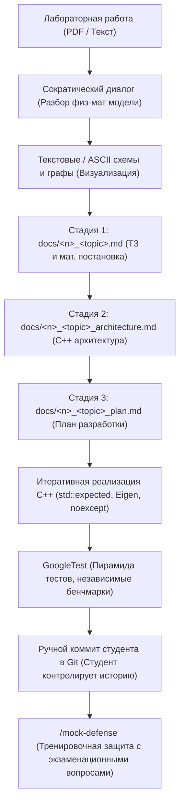

# 🌊 Computational Hydraulics Brain & AI Agent Skill
> **База знаний, архитектурные шаблоны C++ и агентский навык для курсов «Вычислительная гидравлика» и «Теория гидравлических цепей» (Кафедра ИСИТ, РГУ нефти и газа им. И.М. Губкина)**

[](https://en.cppreference.com/w/cpp/20)
[](https://gitlab.com/libeigen/eigen)
[](https://github.com/google/googletest)
[](LICENSE)

---

## 📌 О репозитории

Данный репозиторий представляет собой законченную инженерную базу знаний и автономный специализированный навык (**AI Agent Skill** `computational-hydraulics`) для студентов и разработчиков, выполняющих лабораторные и исследовательские работы по гидравлике трубопроводных систем и расчету сложных гидравлических сетей.

Репозиторий решает главную проблему студента на 3 курсе: **лабораторные задания даются в сухом виде**, без явного раскрытия физической картины и математической постановки. Агент выступает в роли **опытного наставника и Senior C++ разработчика**:
1. Мягко разбирает с вами физическую суть и математическую модель до написания первой строчки кода.
2. Генерирует наглядные схемы, графы и структуру блочных матриц.
3. Проводит разработку по строгому **3-стадийному протоколу кафедры ИСИТ** (ТЗ $\to$ Архитектура $\to$ План $\to$ Код $\to$ GoogleTest).
4. Защищает от фатальных ошибок численных методов (сингулярность матриц, расходимость метода Ньютона, инверсия `A.inverse()`, забытый $P$-узел).
5. Проводит жесткий тренировочный прогон перед защитой лабораторной преподавателю (**Mock Defense**).

---

## 🗂 Структура репозитория

```text
hydraulics-brain/
├── README.md                           # Главное руководство и документация
├── .gitignore                          # Исключение артефактов сборки и кэшей
│
└── computational-hydraulics/           # Автономный инженерный AI Skill
    ├── SKILL.md                        # Главные инструкции агента (Сократический диалог, C++, валидация)
    ├── scripts/
    │   ├── install_skill.sh            # Автоматическая установка для Linux и macOS
    │   └── install_skill.ps1           # Автоматическая установка для Windows PowerShell
    ├── templates/                      # Готовые шаблоны артефактов для лабораторных
    │   ├── AGENTS.md                   # Правила проекта для корня репозитория студента (Doxygen, Code Style, Git)
    │   ├── tz_template.md              # Шаблон ТЗ и физико-математической постановки
    │   ├── architecture_template.md    # Шаблон C++ архитектуры (типы, солверы, лаконичный Doxygen)
    │   └── plan_template.md            # Шаблон пошагового плана и чек-листа
    └── references/                     # Фундаментальная инженерная база знаний
        ├── hydraulics_core.md          # 1D гидравлика: плотность ρ(T,p), вязкость, Re, Дарси-Вейсбах, гидроудар
        ├── sem2_guide.md               # 2 семестр: Бернулли, QP/PP задачи, профилирование, насосы, Task-паттерн
        ├── sem3_guide.md               # 3 семестр: ТГЦ, Eigen C++, PA=LU, МУД, блочные матрицы ККТ, графы
        ├── circuits_and_agentic.md     # Теория гидравлических цепей по Южанину + Агентский протокол ИСИТ
        ├── pitfalls_and_antipatterns.md# Топ-15 критических ловушек и антипаттернов (математика и C++)
        ├── googletest_verification_guide.md # 4-уровневая пирамида GoogleTest и независимые бенчмарки
        └── mock_defense_protocol.md    # Интерактивный симулятор защиты лабораторной (4 раунда)
```

---

## 🚀 Пошаговое руководство по установке навыка

<p align="center">
  &nbsp;&nbsp;&nbsp;&nbsp;&nbsp;&nbsp;
  &nbsp;&nbsp;&nbsp;&nbsp;&nbsp;&nbsp;
  &nbsp;&nbsp;&nbsp;&nbsp;&nbsp;&nbsp;
  &nbsp;&nbsp;&nbsp;&nbsp;&nbsp;&nbsp;
  &nbsp;&nbsp;&nbsp;&nbsp;&nbsp;&nbsp;
  &nbsp;&nbsp;&nbsp;&nbsp;&nbsp;&nbsp;
  &nbsp;&nbsp;&nbsp;&nbsp;&nbsp;&nbsp;
  
</p>

---

### 📥 Шаг 1. Склонируйте репозиторий в любую папку

Склонируйте репозиторий в **любое удобное место на диске** (например, `D:\Study\`, `C:\Dev\` или `~/projects`):

```bash
git clone https://github.com/BugFix-develop/hydraulics-brainstorm.git
cd hydraulics-brainstorm
```

*(Если у вас не установлен Git: нажмите вверху **Code → Download ZIP**, распакуйте архив в любую папку и откройте терминал внутри неё).*

> [!NOTE]
> Все дальнейшие команды запускаются **прямо из этой папки** `hydraulics-brainstorm`, где бы она ни находилась на вашем диске.

---

### ⚡ Шаг 2. Запустите автоматическую установку (в 1 клик)

Скрипт сам определит системные пути вашей ОС и настроит окружение:

 **Linux** /  **macOS** (Bash / Zsh):
```bash
./computational-hydraulics/scripts/install_skill.sh
```

 **Windows** (PowerShell):
```powershell
.\computational-hydraulics\scripts\install_skill.ps1
```

*(В появившемся меню введите номер нужного агента или `9` для установки всем сразу).*

---

### 📦 Ручная установка (по желанию)

Если вы предпочитаете скопировать файлы вручную без скрипта, выберите вашу среду:

<details open>
<summary> &nbsp;<b><font size="+1">OpenAI (Codex Agent & ChatGPT)</font></b></summary>

<br/>

**Codex Agent:**

 **Linux** /  **macOS**:
```bash
mkdir -p ~/.codex/skills
cp -r computational-hydraulics ~/.codex/skills/
```

 **Windows** (PowerShell):
```powershell
New-Item -ItemType Directory -Force -Path "$HOME\.codex\skills"
Copy-Item -Recurse -Force computational-hydraulics "$HOME\.codex\skills\"
```

**ChatGPT (Web / Projects / Custom GPT):**
В [ChatGPT Projects](https://chatgpt.com): в поле *Custom Instructions* вставьте текст из `computational-hydraulics/SKILL.md`, а в *Knowledge* прикрепите файлы из `computational-hydraulics/references/`.
</details>

<details>
<summary> &nbsp;<b><font size="+1">Google Antigravity & Open Agent Skills</font></b></summary>

<br/>

 **Linux** /  **macOS**:
```bash
mkdir -p ~/.agents/skills
cp -r computational-hydraulics ~/.agents/skills/
```

 **Windows** (PowerShell):
```powershell
New-Item -ItemType Directory -Force -Path "$HOME\.agents\skills"
Copy-Item -Recurse -Force computational-hydraulics "$HOME\.agents\skills\"
```
</details>

<details>
<summary> &nbsp;<b><font size="+1">Anthropic Claude Code (CLI)</font></b></summary>

<br/>

 **Linux** /  **macOS**:
```bash
mkdir -p ~/.claude/skills
cp -r computational-hydraulics ~/.claude/skills/
echo -e "\n# Computational Hydraulics Skill\nAlways refer to ~/.claude/skills/computational-hydraulics/SKILL.md when solving hydraulics tasks.\n" >> ~/.claude/CLAUDE.md
```

 **Windows** (PowerShell):
```powershell
New-Item -ItemType Directory -Force -Path "$HOME\.claude\skills"
Copy-Item -Recurse -Force computational-hydraulics "$HOME\.claude\skills\"
Add-Content -Path "$HOME\.claude\CLAUDE.md" -Value "`n# Computational Hydraulics Skill`nAlways refer to $HOME\.claude\skills\computational-hydraulics\SKILL.md when solving hydraulics tasks.`n"
```
</details>

<details>
<summary> &nbsp;<b><font size="+1">Cursor AI IDE (Cursor Rules 2.0)</font></b></summary>

<br/>

Скопируйте правила в репозиторий вашей лабораторной:

 **Linux** /  **macOS**:
```bash
cp computational-hydraulics/templates/AGENTS.md /path/to/my-lab/.cursorrules
```

 **Windows** (PowerShell):
```powershell
Copy-Item -Force computational-hydraulics\templates\AGENTS.md "C:\path\to\my-lab\.cursorrules"
```
</details>

<details>
<summary> &nbsp;<b><font size="+1">Windsurf (Codeium)</font></b></summary>

<br/>

 **Linux** /  **macOS**:
```bash
cp computational-hydraulics/templates/AGENTS.md /path/to/my-lab/.windsurfrules
```

 **Windows** (PowerShell):
```powershell
Copy-Item -Force computational-hydraulics\templates\AGENTS.md "C:\path\to\my-lab\.windsurfrules"
```
</details>

<details>
<summary> &nbsp;<b><font size="+1">Roo Code & Cline (VS Code Extensions)</font></b></summary>

<br/>

 **Linux** /  **macOS**:
```bash
cp computational-hydraulics/templates/AGENTS.md /path/to/my-lab/.clinerules
```

 **Windows** (PowerShell):
```powershell
Copy-Item -Force computational-hydraulics\templates\AGENTS.md "C:\path\to\my-lab\.clinerules"
```
</details>

<details>
<summary> &nbsp;<b><font size="+1">Aider CLI (Terminal Pair Programmer)</font></b></summary>

<br/>

 **Linux** /  **macOS**:
```bash
aider --read ~/.agents/skills/computational-hydraulics/SKILL.md
```

 **Windows** (PowerShell):
```powershell
aider --read "$HOME\.agents\skills\computational-hydraulics\SKILL.md"
```
</details>

<details>
<summary> &nbsp;<b><font size="+1">GitHub Copilot (VS Code / JetBrains / CLI)</font></b></summary>

<br/>

 **Linux** /  **macOS**:
```bash
mkdir -p /path/to/my-lab/.github
cp computational-hydraulics/templates/AGENTS.md /path/to/my-lab/.github/copilot-instructions.md
```

 **Windows** (PowerShell):
```powershell
New-Item -ItemType Directory -Force -Path "C:\path\to\my-lab\.github"
Copy-Item -Force computational-hydraulics\templates\AGENTS.md "C:\path\to\my-lab\.github\copilot-instructions.md"
```
</details>

---

### ✅ Шаг 3. Как проверить активацию навыка

1. Откройте вашего ИИ-агента и напишите:
   > *«Привет! Помоги решить задачу по гидравлике.»*
2. **Если навык активен:**
   - Агент **не пишет код вслепую**, а начинает Сократический диалог (уточняет $Re$, режим течения, граничные условия).
   - Предлагает нарисовать схему сети/графа.
   - Строит разработку по 3-стадийному протоколу: `ТЗ` → `Архитектура` → `План` → `GoogleTests`.
   - Напоминает, что коммиты в Git вы делаете **лично**.

---

## 🛠 Рабочий процесс студента и агента



### 1. Сократический диалог перед кодом
Агент не вываливает сразу портянку C++ кода. Сначала он задает студенту наводящие вопросы:
- Какова физическая постановка (QP или PP задача, несжимаемая жидкость или реальный газ)?
- В какой зоне сопротивления работает трубопровод (гидравлически гладкая, переходная, шероховатая)?
- Корректен ли граф сети (нет ли изолированных компонент, зафиксирован ли хотя бы один узел по давлению)?

### 2. Строгий 3-стадийный протокол ИСИТ
Никакого кода до утверждения проектной документации в `docs/`:
1. `docs/<n>_<topic>.md` — математическая постановка, единицы измерения в СИ, граничные условия.
2. `docs/<n>_<topic>_architecture.md` — структуры данных, RAII-обертки, отсутствие голых указателей, Doxygen-документация.
3. `docs/<n>_<topic>_plan.md` — атомарные чек-боксы шагов реализации и верификации.

### 3. Золотое правило работы с Git
> **Важно**: Агент никогда не коммитит и не пушит код автоматически! Студент сам выполняет `git add`, `git commit` и `git push`, полностью контролируя ветки и историю своего репозитория.

### 4. Стандарт GoogleTest без тавтологий
- Запрещены тавтологические тесты (`EXPECT_DOUBLE_EQ(solve(x), solve(x))`).
- Эталонные значения рассчитываются независимым аналитическим скриптом или берутся из проверенных задачников (Идельчик, Альтшуль, Лурье).
- Обязательная проверка краевых случаев: $Re \to 0$, $Q \to 0$, $D \to \infty$, вырожденные матрицы, обратный ток.

### 5. Режим Mock Defense (`/mock-defense`)
После завершения работы агент запускает симулятор защиты:
- Раунд 1: Физика процессов (закон сохранения импульса, потеря напора, кавитация).
- Раунд 2: Численные методы (почему $PA=LU$, а не `A.inverse()`, сходимость МУД).
- Раунд 3: C++ & Архитектура (Move-семантика, шаблоны выражений Eigen `const auto&`, cache-locality).
- Раунд 4: Анализ кода и разбор ошибок.

---

## 📚 Литература и фундаментальные источники

База знаний и алгоритмы верифицированы по классическим фундаментальным трудам:
1. **Лурье М.В.** *Математическое моделирование процессов трубопроводного транспорта нефти, нефтепродуктов и газа.* — М.: ФГУП Изд-во «Нефть и газ» РГУ нефти и газа им. И.М. Губкина, 2012. — 456 с.
2. **Лурье М.В.** *Трубопроводный транспорт нефти.* — М.: ФГУП Изд-во «Нефть и газ» РГУ нефти и газа им. И.М. Губкина, 2003.
3. **Идельчик И.Е.** *Справочник по гидравлическим сопротивлениям.* — М.: Машиностроение, 1992. — 672 с.
4. **Альтшуль А.Д.** *Гидравлические сопротивления.* — М.: Недра, 1982. — 224 с.
5. **Некрасов Б.Б.** *Гидравлика и гидропривод.* — М.: Высшая школа, 1989. — 296 с.
6. **Южанин В.В.** *Материалы лекций и практических занятий по теории гидравлических цепей и численным методам.* — Кафедра ИСИТ, РГУ нефти и газа им. И.М. Губкина.

---

## 🤝 Вклад и участие
Если вы студент или преподаватель Губкинского университета и хотите дополнить базу новыми методичками, расчетными схемами или тестами:
1. Создайте `fork` репозитория.
2. Создайте ветку под вашу фичу (`git checkout -b feature/new-hydraulic-case`).
3. Сделайте коммит (`git commit -m "feat: add local resistance calculation for venturi nozzle"`).
4. Создайте `Pull Request`.
