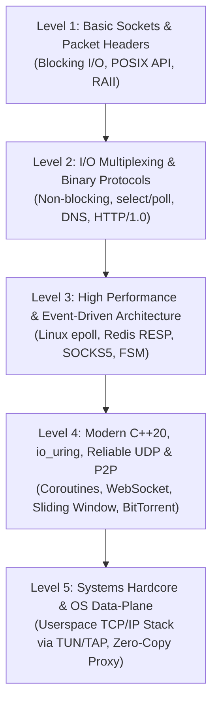

# C++ Pet Projects Roadmap: From Fundamentals to Systems Hardcore

> This roadmap is structured on the principle of **incremental complexity**.
> Each level builds directly upon the concepts mastered in the previous one: starting from basic blocking sockets and packet header parsing, progressing through I/O multiplexing and Event Loops, to modern C++20 coroutines, P2P networks, and a complete userspace TCP/IP stack.

---

## Complexity Level Map

---

## 🟢 Level 1: Fundamentals (Sockets, RAII & Packet Structures)
**Goal:** Master the core POSIX Sockets API, learn to encapsulate file descriptors safely using RAII, and understand how bytes are packed into network wire headers.

---

### Project 1.1. RAII Socket Wrapper & Multi-Threaded Echo Server
* **Overview:** Implement a server and CLI client in clean modern C++. The server receives incoming messages and echoes them back. Each new client connection is handled in a dedicated thread.
* **Key Learning Outcomes:**
  * System calls: `socket()`, `bind()`, `listen()`, `accept()`, `connect()`, `recv()`, `send()`, `close()`.
  * Designing a robust `socket_t` class where the descriptor closes deterministically in the destructor, copy operations are deleted, and move semantics are supported.
  * Modern C++20 threads (`std::jthread`) with cooperative cancellation via `std::stop_token`.
* **Testing:** Connect via `netcat` (`nc 127.0.0.1 8080`) or `telnet`.
* **Estimated Effort:** 1–2 evenings.

---

### Project 1.2. CLI Ping Utility on Raw Sockets
* **Overview:** A command-line clone of the system `ping` utility. Constructs ICMP `Echo Request` packets, transmits them to a target host, awaits the `Echo Reply`, and measures Round-Trip Time (RTT).
* **Key Learning Outcomes:**
  * Raw sockets: `AF_INET`, `SOCK_RAW`, `IPPROTO_ICMP`.
  * Network byte order conversion: `htons()`, `ntohs()`, `htonl()`, `ntohl()`.
  * Internet Checksum calculation (RFC 1071): 16-bit word summation with one's complement.
  * High-resolution wall-clock timing using `std::chrono::steady_clock`.
* **Estimated Effort:** 2–3 days.

---

### Project 1.3. Offline `.pcap` Traffic Dump Parser (Toy Wireshark Core)
* **Overview:** Parse binary `.pcap` packet capture files (recorded via Wireshark or `tcpdump`) and decode layer headers.
* **Key Learning Outcomes:**
  * Header dissection: Global PCAP Header → Packet Header → Ethernet Frame → IPv4 Header → TCP/UDP.
  * Zero-copy buffer views using `std::span<const uint8_t>` and `std::string_view` without dynamic allocations.
  * Generating traffic statistics: top IP addresses by bytes transferred, protocol distribution breakdown.
* **Estimated Effort:** 3–4 days.

---

## 🟡 Level 2: Multiplexing & Binary Protocols
**Goal:** Move away from the thread-per-connection anti-pattern, handle thousands of sockets within a single thread, and parse application-layer binary protocols.

---

### Project 2.1. CLI DNS Resolver (Domain Lookup over UDP)
* **Overview:** A utility that constructs binary DNS Type `A` (IPv4) queries for domain names (e.g., `google.com`), sends them to public resolvers (`8.8.8.8`) over UDP port 53, and parses the response.
* **Key Learning Outcomes:**
  * Binary DNS protocol structure (RFC 1035): Query ID, bit flags (QR, Opcode, RD), Question and Answer sections.
  * DNS Name Compression algorithm (offset pointers `0xC0XX`): recursive offset resolution.
  * Handling UDP timeouts via `SO_RCVTIMEO` or readiness polling.
* **Estimated Effort:** 4–5 days.

---

### Project 2.2. Single-Threaded Chat Server via `poll()` / `select()`
* **Overview:** A chat server maintaining 50–100 simultaneous client connections within a single operating system thread. When one client broadcasts a message, it is disseminated to all peers.
* **Key Learning Outcomes:**
  * Non-blocking socket configuration (`fcntl(fd, F_SETFL, O_NONBLOCK)`).
  * I/O Multiplexing principles using POSIX `poll()` (`struct pollfd` array).
  * Managing partial reads and writes: per-connection input and output ring buffers.
  * Graceful connection termination handling (EOF, `read() == 0`, `ECONNRESET`).
* **Estimated Effort:** 1 week.

---

### Project 2.3. Static HTTP/1.0 Web Server
* **Overview:** A lightweight HTTP server parsing `GET /index.html HTTP/1.0` requests, locating static files on disk, and serving them with correct `Content-Type` headers and status codes (`200 OK`, `404 Not Found`).
* **Key Learning Outcomes:**
  * String parsing for HTTP request lines and header blocks.
  * Directory traversal protection (`GET /../../etc/passwd` path normalization).
  * Reading files from disk and streaming to client sockets.
* **Estimated Effort:** 1 week.

---

## 🟠 Level 3: High Concurrency & Event-Driven Architecture
**Goal:** Adopt production standards for Linux network daemons: scalable `epoll`, Finite State Machines (FSM), and high-throughput protocols.

---

### Project 3.1. In-Memory Key-Value Store (Mini-Redis with RESP Protocol)
* **Overview:** An in-memory key-value database controlled through the official `redis-cli` client. Supports commands: `SET`, `GET`, `DEL`, `EXPIRE`, `INCR`.
* **Architecture:**
  * Scalable Event Loop built on Linux `epoll` in Edge-Triggered mode (`EPOLLET`).
  * Zero-copy parser for RESP (Redis Serialization Protocol): strings, arrays, integers.
  * Concurrent hash table: `std::unordered_map` with fine-grained or lockless access.
  * Background key expiry sweeps (active sampling + lazy expiration on access).
* **Key Learning Outcomes:** Solving the C10k concurrency problem, handling `EAGAIN` / `EWOULDBLOCK`, benchmarking with `redis-benchmark`.
* **Estimated Effort:** 2–3 weeks.

---

### Project 3.2. SOCKS5 Proxy Server (RFC 1928)
* **Overview:** A proxy daemon capable of tunneling web browser and Telegram traffic. The client connects, requests an outbound target (`example.com:443`), and the proxy establishes the remote connection and relays bytes transparently.
* **Key Learning Outcomes:**
  * Session Finite State Machine (FSM): `HANDSHAKE_AUTH` → `HANDSHAKE_REQUEST` → `TUNNEL_STREAMING`.
  * Asynchronous outbound connection: non-blocking `connect()` and waiting for `EPOLLOUT`.
  * Bidirectional byte stream forwarding between paired sockets without redundant user-space copying.
* **Estimated Effort:** 2 weeks.

---

### Project 3.3. Layer 4 Reverse Proxy & Load Balancer
* **Overview:** A TCP load balancer listening on an ingress port (e.g., 80) and distributing client connections across a pool of backend servers.
* **Key Features:**
  * Load balancing algorithms: Round Robin, Least Connections, IP Hash.
  * Active background health checks: periodic pinging and dynamic pool pruning.
* **Estimated Effort:** 2 weeks.

---

## 🔴 Level 4: Modern C++20, io_uring, Reliable UDP & P2P
**Goal:** Transition to cutting-edge C++ language features (coroutines), modern Linux asynchronous kernel interfaces (`io_uring`), and distributed peer-to-peer protocols.

---

### Project 4.1. Asynchronous Coroutine HTTP/1.1 & WebSocket Server (C++20)
* **Overview:** A high-throughput server written without callback hell. Request handling logic reads like synchronous linear code powered by `co_await`.
* **Key Features:**
  * Custom `task<T>` coroutine return type and custom `awaiter` implementations for socket I/O.
  * Integration with Linux `io_uring` (`liburing`) to eliminate syscall overhead.
  * Full WebSocket support: handshake (SHA-1 + Base64), masked frame decoding, text/binary framing.
  * Zero-copy static file streaming via `sendfile(2)`.
* **Estimated Effort:** 3–4 weeks.

---

### Project 4.2. Reliable UDP Transport (Mini-QUIC / Game Protocol)
* **Overview:** Implement a custom reliable transport protocol on top of UDP, similar to WebRTC data channels, game network engines, or HTTP/3 (QUIC).
* **Key Features:**
  * Packet header: `SequenceNumber`, `AckNumber`, `AckBitfield`.
  * Selective ACK: acknowledging up to 32–64 prior packets in a single bitmask.
  * Sliding Window flow control, Smoothed RTT (SRTT) estimation, and dynamic Retransmission Timeout (RTO).
  * Dual-channel streaming: Reliable Ordered for critical events vs Unreliable for fast state telemetry.
* **Estimated Effort:** 3 weeks.

---

### Project 4.3. BitTorrent Client (Decentralized P2P Network)
* **Overview:** A CLI client downloading files from real BitTorrent swarms using a `.torrent` metainfo file.
* **Key Features:**
  * Bencode parser (dictionaries, lists, byte strings, integers).
  * Tracker communication: HTTP and UDP Tracker Protocol (BEP 15) to fetch peer lists.
  * Peer Wire Protocol implementation: `Handshake`, `bitfield`, `interested`, `unchoke`, requesting 16 KB blocks.
  * Cryptographic SHA-1 verification of downloaded pieces.
* **Estimated Effort:** 4–6 weeks.

---

## 🔥 Level 5: Systems Hardcore (OS Architecture & Kernel Bypass)
**Goal:** Deep systems programming bypassing the standard OS networking stack.

---

### Project 5.1. Userspace TCP/IP Stack over Linux TUN/TAP
* **Overview:** Implement an autonomous TCP/IP network stack executing entirely in userspace. Reads raw Ethernet/IP frames from `/dev/net/tun`.
* **Key Features:**
  * ARP Protocol: IP-to-MAC resolution and dynamic ARP cache maintenance.
  * IPv4 Protocol: header validation, checksum calculation, TTL handling, subnet routing.
  * ICMP Protocol: generating Ping responses.
  * Full TCP Protocol implementation:
    * Complete TCP state machine: `LISTEN`, `SYN_SENT`, `SYN_RECEIVED`, `ESTABLISHED`, `FIN_WAIT_1`, `FIN_WAIT_2`, `CLOSE_WAIT`, `LAST_ACK`, `TIME_WAIT`.
    * Transmit and receive reassembly ring buffers.
    * Packet drop recovery, Slow Start, and Congestion Avoidance algorithms.
* **Estimated Effort:** 1.5–2 months.

---

### Project 5.2. High-Performance L4 Proxy with Thread-per-Core Architecture
* **Overview:** An enterprise-grade proxy modeled on the Shared-Nothing architecture (as used in Envoy, Seastar, and ScyllaDB).
* **Key Features:**
  * Hard CPU core pinning for worker threads (`pthread_setaffinity_np`).
  * Lock-free design: worker communication via Single-Producer Single-Consumer (SPSC) lockless ring buffers.
  * Zero-copy I/O streaming using `splice(2)` or `io_uring`.
* **Estimated Effort:** 1 month.

---

## 🧭 First Week Starter Plan

1. **Days 1–2:** Build **Project 1.1** (RAII Socket + TCP Echo Server). Write the RAII wrapper around the file descriptor, verify with `netcat`.
2. **Days 3–4:** Build **Project 1.2** (CLI Ping). Construct ICMP headers byte-by-byte and compute checksums. Inspect packets in Wireshark.
3. **Days 5–7:** Tackle **Project 2.2** (Single-threaded chat server with `poll()`). This provides the fundamental mental model for asynchronous I/O.
